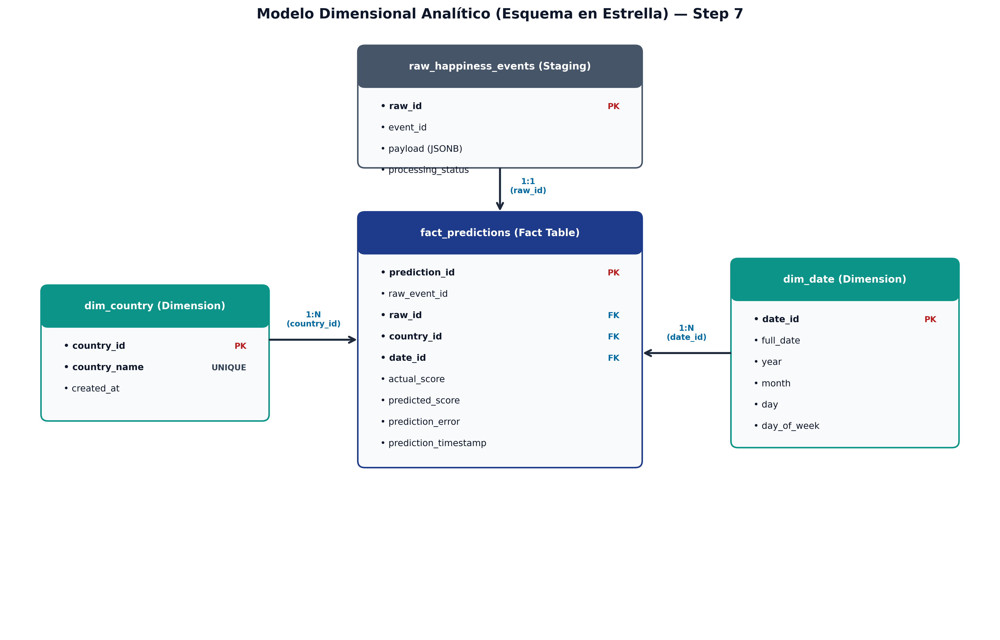
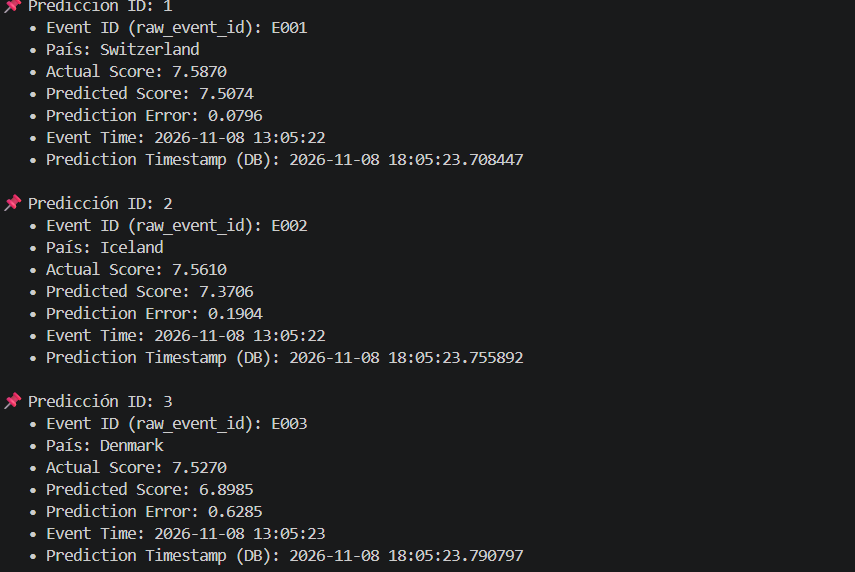
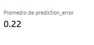
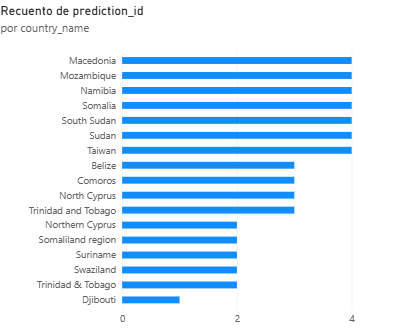
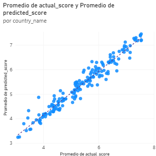
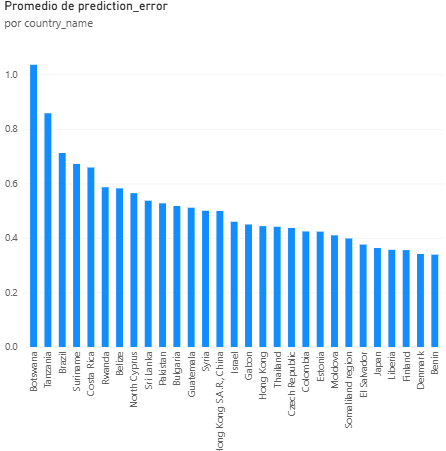

# 🌍 Taller 3: Streaming ETL con Apache Kafka y Machine Learning

Este repositorio contiene la **Parte A** del proyecto: Ingesta, Limpieza de Datos, Feature Engineering y Entrenamiento del Modelo de Regresión para predecir el puntaje de felicidad (*Happiness Score*).

---

## 📌 PARTE A: Data Profiling y Machine Learning

## 🔍 Step 1 — Exploratory Data Analysis (EDA)

Se evaluó la calidad, consistencia y estructura de los datos históricos del *World Happiness Report* (2015–2019) almacenados en `data/raw/` antes de su ingesta en el pipeline.

---

### Observaciones y Hallazgos de Calidad de Datos

#### 1. Diferencias de Esquema (Schema Differences)
Las nomenclaturas de las columnas varían entre las entregas anuales.
* **Resultado:** La columna de país varía entre `Country` (2015-2017) y `Country or region` (2018-2019), mientras que la variable objetivo adopta los nombres `Happiness Score`, `Happiness.Score` y `Score`. Se requiere un mapeo de estandarización previo a la ingesta.

#### 2. Valores Nulos (Missing Values)
Evaluación de integridad de los datos en los 5 archivos históricos.
* **Resultado:** Integridad del 100% en 2015, 2016, 2017 y 2019. Únicamente se detectó **1 valor nulo** en la columna `Perceptions of corruption` correspondiente al dataset de **2018**.

#### 3. Registros Duplicados e Inconsistencias (Duplicated Records & Types)
Verificación de duplicidad y validación de tipos de datos de las variables.
* **Resultado:** **0 filas duplicadas** en todos los datasets. Correcta tipificación con nombres de países en texto (`str`) y variables numéricas en punto flotante (`float64`).

#### 4. Valores Fuera de Rango (Outliers)
Inspección de distribuciones numéricas sobre los factores socioeconómicos.
* **Resultado:** Las variables se mantienen dentro de los rangos metodológicos teóricos (ej. puntaje de felicidad entre ~2.69 y ~7.77). Los valores mínimos (`0.0`) corresponden legítimamente a los países de la cola inferior del reporte.

#### Propuesta de Esquema Unificado (Unified Schema Proposal):

| Columna Estandarizada | Descripción | Mapeo Original (2015-2017 / 2018-2019) | Tipo de Dato |
| :--- | :--- | :--- | :--- |
| `country` | Nombre del país | `Country` / `Country or region` | `str` |
| `year` | Año del registro | Extraído del metadato del archivo | `int` |
| `actual_happiness_score` | Puntaje de felicidad (Target) | `Happiness Score` / `Happiness.Score` / `Score` | `float` |
| `gdp` | PIB per cápita | `Economy (GDP per Capita)` / `GDP per capita` | `float` |
| `family` | Apoyo social | `Family` / `Social support` | `float` |
| `health` | Esperanza de vida | `Health (Life Expectancy)` / `Healthy life expectancy` | `float` |
| `freedom` | Libertad de tomar decisiones | `Freedom` / `Freedom to make life choices` | `float` |
| `generosity` | Generosidad | `Generosity` | `float` |
| `corruption` | Percepción de corrupción | `Trust (Government Corruption)` / `Perceptions of corruption` | `float` |

---

##  Step 2 — Data Cleaning and Harmonization

Se implementó un pipeline automatizado de limpieza, estandarización y consolidación de los 5 archivos CSV históricos en un único dataset procesado.

---

### Acciones de Limpieza y Transformación

#### 1. Estandarización de Esquema 
Homologación de nombres de columnas a lo largo de las entregas de 2015 a 2019.
* **Resultado:** Mapeo y renombrado unificado de todas las variables hacia un esquema de nombres consistente y libre de caracteres especiales.

#### 2. Tratamiento de Imputación de Nulos 
Gestión del dato faltante detectado en el factor de corrupción.
* **Resultado:** Imputación del valor nulo en `corruption` (2018) utilizando la **mediana** de ese mismo año, preservando el tamaño muestral sin sesgar la distribución de la variable.

#### 3. Depuración de Atributos 
Filtro de variables irrelevantes o inconsistentes entre años (errores estándar, intervalos de confianza y rangos).
* **Resultado:** Eliminación de columnas no homogéneas para consolidar una estructura final ajustada de **9 variables principales**.

#### 4. Consolidación y Exportación 
Concatenación de los datos históricos agregando la dimensión temporal implícita.
* **Resultado:** Generación del dataset unificado `data/processed/cleaned_happiness.csv` con **782 filas y 9 columnas**, listo para modelado e ingesta.

---

## Step 3 — Feature Engineering

Se preparó el conjunto de características (features) y se aplicó la transformación estadística requerida para el entrenamiento del modelo predictivo.

---

### Transformaciones y Selección de Variables

#### 1. Selección de Atributos y Target 
Definición de variables explicativas socioeconómicas y la variable objetivo a predecir.
* **Resultado:** Matriz de características conformada por `gdp`, `family`, `health`, `freedom`, `generosity` y `corruption`. Variable objetivo configurada como `actual_happiness_score`.

#### 2. Control de Fuga de Datos 
Filtrado riguroso de atributos no predictivos o deterministas.
* **Resultado:** Exclusión total de identificadores categóricos (`country`, `year`) y columnas de posicionamiento directo (`Rank`) para garantizar un aprendizaje supervisado sin sesgos.

#### 3. Análisis de Correlación 
Evaluación cuantitativa de la relación lineal entre las variables explicativas y el puntaje de felicidad.
* **Resultado:** Confirmación de fuertes correlaciones positivas directas con PIB (`gdp`), apoyo social (`family`) y esperanza de vida (`health`).

#### 4. Escalamiento de Características 
Normalización de las variables numéricas a una misma escala.
* **Resultado:** Integración de `StandardScaler` dentro de un `Pipeline` de scikit-learn, asegurando la transformación adecuada y evitando data leakage entre los conjuntos de entrenamiento y prueba.

---

##  Step 4 — Train Regression Model

Se construyó, evaluó y serializó el modelo de Machine Learning supervisado para la predicción del puntaje de felicidad.

---

### Proceso de Entrenamiento y Validación

#### 1. Particionamiento del Dataset
División estratificada del conjunto de datos histórico procesado.
* **Resultado:** Separación de datos en 70% entrenamiento (**547 registros**) y 30% prueba (**235 registros**), garantizando reproducibilidad mediante `random_state=42`.

#### 2. Arquitectura del Modelo y Pipeline
Encapsulamiento del flujo de transformación y estimación.
* **Resultado:** Construcción de un `Pipeline` con `StandardScaler` y un algoritmo `RandomForestRegressor` (100 estimadores), asegurando la reproducibilidad total de la inferencia.

#### 3. Métricas de Evaluación 
Validación cuantitativa sobre el conjunto de prueba independiente.
* **Resultado:**
  * **MAE (Mean Absolute Error):** `0.4069`
  * **RMSE (Root Mean Squared Error):** `0.5239`
  * **R² (R-Squared):** `0.7802` (el modelo explica el 78.02% de la variabilidad del puntaje de felicidad).

#### 4. Serialización del Artefacto 
Persistencia del modelo listo para producción.
* **Resultado:** Exportación del pipeline entrenado en la ruta `models/model.pkl` para su consumo directo en el consumidor de Kafka.

---

## Step 5 — Kafka Producer & Event Contract

Se desarrolló el productor de eventos en Python (`kafka/producer.py`) y el módulo de validación de contrato (`kafka/event_contract.py`) para simular la transmisión en tiempo real hacia Apache Kafka en Docker.

---

### Componentes y Reglas de Ingesta

#### 1. Configuración del Topic y Particionamiento (Topic Architecture)
Creación y administración de la infraestructura del mensaje en Kafka.
* **Resultado:** Configuración del topic `happiness-events` con **3 particiones** y un **factor de replicación de 1**. Transmisión mediante clave (`key = country`) para asegurar el particionamiento dinámico y el orden cronológico estricto por país.

#### 2. Simulación de Streaming en Tiempo Real (Streaming Ingestion)
Procesamiento iterativo de los datos unificados.
* **Resultado:** Lectura y envío registro a registro desde `data/processed/cleaned_happiness.csv` hacia el cluster con un tiempo de espera configurable (`DELAY_SECONDS = 0.5`).

#### 3. Estructura y Serialización de Eventos (JSON Payload Schema)
Serialización de los datos bajo una estructura de evento estandarizada.
* **Resultado:** Formateo estricto del payload en JSON codificado en UTF-8 con metadatos de auditoría (`event_id`, `event_time` en formato ISO-8601).

   ```json
   {
     "event_id": "E001",
     "country": "Colombia",
     "year": 2019,
     "gdp": 1.2,
     "family": 0.8,
     "health": 0.9,
     "freedom": 0.6,
     "generosity": 0.3,
     "corruption": 0.1,
     "actual_happiness_score": 6.2,
     "event_time": "2026-11-07T10:58:24"
   }


---

## Step 6 — Kafka Consumer & Real-Time Inference

Se implementó el servicio consumidor en Python (`kafka/consumer.py`) integrado en el consumer group `happiness-ml-team`, encargado del procesamiento en tiempo real, auditoría raw, inferencia y persistencia dimensional.

---

### Flujo de Procesamiento e Inferencia

#### 1. Auditoría Raw e Ingestion Trace (RAW Event Store)
Registro completo del payload original en la tabla `raw_happiness_events` de PostgreSQL previo a cualquier transformación.
* **Resultado:** Captura persistente de metadatos de Kafka (`partition`, `offset`), payload en JSON y estado de auditoría inicial (`VALID`, `INVALID_SCHEMA`, `INVALID_VALUES`).

#### 2. Tolerancia a Fallos y Validación de Contrato (Fault Tolerance & Contract Check)
Evaluación en tiempo real del evento mediante `event_contract.py`.
* **Resultado:** Los eventos corruptos o fuera de esquema son etiquetados con el motivo del fallo en `raw_happiness_events` y descartados para la inferencia, garantizando la continuidad operativa sin detener el pipeline.

#### 3. Inferencia de ML en Tiempo Real (Real-Time Inference)
Extracción de variables explicativas y ejecución del modelo serializado para eventos con estado `VALID`.
* **Resultado:** Invocación en memoria a `models/model.pkl` pasando las 6 características en el orden exacto de entrenamiento, calculando en caliente la predicción (`predicted_score`) y el error absoluto (`prediction_error = |actual - predicted|`).

#### 4. Persistencia en Modelo Dimensional (Data Warehouse Persistence)
Almacenamiento de las métricas resultantes sobre la capa de analítica.
* **Resultado:** Inserción directa de cada evento procesado con su predicción y margen de error en la tabla de hechos `fact_predictions`, quedando disponible de inmediato para consultas y Power BI.

---

### Step 7 — Database Design

Diseñamos e implementamos un modelo dimensional analítico (esquema en estrella) en PostgreSQL para separar la capa de ingesta/auditoría (*Staging*) de la capa de análisis de predicciones (*Analytics*).

#### Arquitectura Dimensional (Star Schema)


#### 1. Capa RAW / Staging (`raw_happiness_events`)
Preservación de la carga útil (payload JSON) original transmitida por Apache Kafka antes de cualquier transformación o inferencia.
* **Resultado:** Trazabilidad completa con metadatos de Kafka (`topic_name`, `kafka_partition`, `kafka_offset`), control de estados (`VALID`, `INVALID_SCHEMA`, `INVALID_VALUES`) y registro de fallos en `error_message`.

#### 2. Capa de Dimensiones (Lookup Tables)
Normalización de entidades de contexto para optimización de consultas y agregaciones analíticas.
* **Resultado:** 
  * **`dim_country`:** Desacopla los nombres de países eliminando la redundancia de texto mediante `country_id` como clave primaria.
  * **`dim_date`:** Desglosa la temporalidad del evento en clave sintética (`date_id` en formato `YYYYMMDD`), permitiendo agregaciones flexibles por año, mes, día y día de la semana.

#### 3. Capa de Hechos (`fact_predictions`)
Tabla central del modelo en estrella para el almacenamiento de métricas numéricas y resultados del modelo de Machine Learning.
* **Resultado:** Consolidación de valores reales (`actual_score`), predicciones (`predicted_score`) y márgenes de error (`prediction_error`), vinculados mediante claves foráneas (`FK`) a `dim_country`, `dim_date` y `raw_happiness_events`.

#### 4. Automatización Relacional en Ingesta (Consumer Pipeline Integration)
Gestión del poblamiento dinámico e integridad referencial desde `kafka/consumer.py`.
* **Resultado:** Secuencia automatizada de inserción que registra el evento raw, resuelve o crea dinámicamente las claves en las dimensiones `dim_country` y `dim_date`, ejecuta la inferencia en tiempo real y persiste la métrica en `fact_predictions` manteniendo 100% de integridad referencial.

---

### Step 8 — Load Raw Events and Prediction Results

Implementamos y validamos la persistencia doble y la trazabilidad end-to-end de los eventos consumidos desde Apache Kafka hacia PostgreSQL.

#### 1. Requerimientos Cumplidos
- **Almacenamiento RAW:** Preservación del mensaje JSON original en `raw_happiness_events` conservando metadatos de mensajería (`topic`, `partition`, `offset`).
- **Persistencia Analítica:** Registro de `actual_score`, `predicted_score` y el cálculo en tiempo real de `prediction_error` ($|actual - predicted|$).
- **Trazabilidad Temporal y Causal:** Registro de `event_time` (marca temporal del evento en el origen) y `prediction_timestamp` (marca de tiempo de la inserción en base de datos).
- **Enlace Relacional Causal:** Vinculación directa mediante `raw_event_id` y `raw_id` (FK), garantizando que cada inferencia analítica pueda rastrearse hasta el payload exacto emitido por el Producer.

#### 2. Auditoría de Integridad de Datos
Mediante el script de verificación `kafka/verify_step8_traceability.py`, se auditó el 100% de la ingesta en PostgreSQL:
- **Total de predicciones analíticas:** 782
- **Total de eventos RAW enlazados:** 782 (100% de trazabilidad garantizada)

#### Evidencia de Auditoría en Terminal


---

## 📊 Step 9 — Dashboard and KPIs (Power BI)

Se implementó un panel interactivo en **Power BI Desktop** conectado directamente a la base de datos PostgreSQL (`happiness_db`), consumiendo el modelo dimensional (`fact_predictions`, `dim_country`, `dim_date`) sin utilizar archivos CSV estáticos.

---

### Visualizaciones y KPIs

#### 1. KPI 1: Error Promedio Global (Average Prediction Error)
Mide la desviación global del modelo comparando el valor real del puntaje de felicidad contra la predicción generada en el pipeline.



* **Resultado:** Error promedio global de **0.22**, reflejando una alta precisión general del modelo.

#### 2. KPI 2: Predicciones por País (Predictions by Country)
Visualiza el volumen total de predicciones procesadas e ingertadas en la base de datos por país.



* **Resultado:** Muestra la distribución de carga y confirma el procesamiento continuo de eventos en Kafka por país.

#### 3. KPI 3: Puntaje Actual vs. Predicho (Predicted vs. Actual Score)
Evalúa la correlación entre el valor real (`actual_score`) y la predicción (`predicted_score`) agrupado por país.



* **Resultado:** Alineación diagonal uniforme que confirma un fuerte ajuste del modelo de Machine Learning.

#### 4. KPI 4: Distribución del Error por País (Prediction Error Distribution)
Analiza la varianza del error de predicción desglosada por país para detectar sesgos regionales.



* **Resultado:** Identifica países con mayor margen de desviación (ej. Botswana) frente a aquellos con menor varianza (ej. Benin, Dinamarca).

---
